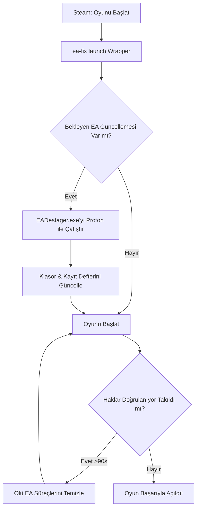

# ea-fix 🚗💨

> **Linux / Debian / Ubuntu / Steam Deck:** Steam Proton altında çalışan EA oyunlarında (Need for Speed, Battlefield vb.) yaşanan EA App **güncelleme döngüsü** ve **"Haklar doğrulanıyor..." takılma** sorunlarını otomatik çözen hafif ve otonom araç.

---

## 🇹🇷 Türkçe Açıklama

### Karşılaşılan Sorunlar
1. **EA App Güncelleme Kapanma Döngüsü (Hata Kodu Yok):**
   - EA App zorunlu bir istemci güncellemesi indirir (`machine.updatepending=1`).
   - Normalde bu güncellemeyi uygulayan `EADestager.exe`, Wine/Proton arka plan servisi altından başlatılamaz.
   - EA App her açılışta güncellemeyi uygulamak için anında kapanır; oyun hiç açılmaz ve ekrana hiçbir hata kodu gelmez.
2. **"Haklar doğrulanıyor..." (Verifying rights) Sonsuz Takılması:**
   - Oyun kapandıktan sonra EA App yerel lisans dosyalarını temizler.
   - Sonraki açılışta CEF (tarayıcı/kimlik) servisi token isteğine yanıt veremezse, oyun açılış ekranında sonsuza kadar takılı kalır.

### Çözüm
`ea-fix`:
- Steam kütüphanelerindeki ve Proton `compatdata` dizinlerindeki EA App öneklerini (prefix) otomatik tespit eder.
- İndirilmiş ama kurulamamış güncellemeleri Proton ortamında `EADestager.exe` üzerinden doğrudan uygular ve sürüm dizinlerini eşitler.
- Steam başlatma seçeneklerine eklenen koruyucu sarmalayıcı (`ea-fix launch -- %command%`) ile gelecekteki tüm güncellemeleri oyun başlamadan önce otonom olarak uygular.
- Lisans doğrulama aşamasında takılma algıladığında ölü süreçleri güvenle temizleyip oyunu otomatik olarak yeniden başlatır.

---

## 📦 Kurulum (Installation)

### Yöntem 1: Debian / Ubuntu / Linux Mint (.deb Paketi)
Debian tabanlı sistemlerde tek komutla `.deb` paketini oluşturup kurabilirsiniz:

```bash
git clone https://github.com/dnzsngz1/ea-fix.git
cd ea-fix
make deb
sudo dpkg -i dist/ea-fix_1.0.0_all.deb
```

Veya hazır oluşturulmuş paketi kurmak için:
```bash
sudo dpkg -i dist/ea-fix_1.0.0_all.deb
```

### Yöntem 2: Hızlı Kurulum Scripti (Tüm Linux Dağıtımları)
```bash
sudo ./install.sh
```
veya:
```bash
sudo make install
```

---

## 🚀 Kullanım (Usage)

Kurulum tamamlandıktan sonra terminalden doğrudan `ea-fix` komutunu kullanabilirsiniz:

### 1. Durumu Kontrol Etme
Sistemdeki tüm Steam kütüphanelerini, EA oyun öneklerini ve bekleyen güncelleme olup olmadığını listeler:
```bash
ea-fix status
```

### 2. Bekleyen Güncellemeleri Hemen Düzeltme
Oyun açılmıyorsa tek bir komutla bekleyen EA App güncellemesini hemen uygular:
```bash
ea-fix fix
```

### 3. Steam Başlatma Seçeneğini Otomatik Ayarlama (Tekrarlanmaması İçin)
Steam'deki tüm EA oyunlarının (veya istediğiniz AppID'nin) başlatma parametresine koruma sarmalayıcısını ekler:
```bash
# Steam açıkken otomatik kapatıp ayarlar:
ea-fix install --stop-steam
```

Belirli bir oyun için (örneğin Need for Speed - AppID `1262540`):
```bash
ea-fix install --appid 1262540 --stop-steam
```

### 4. Elle Steam Başlatma Seçeneği (İsteğe Bağlı)
İsterseniz Steam'de oyunun özelliklerine girip Başlatma Seçenekleri (Launch Options) kısmına kendiniz de ekleyebilirsiniz:
```text
PROTON_EAC_RUNTIME=1 ea-fix launch -- %command%
```

### 5. Ayarı Kaldırma
Steam başlatma seçeneklerinden sarmalayıcıyı temizlemek için:
```bash
ea-fix uninstall --stop-steam
```

---

## 🛠️ Nasıl Çalışır? (Architecture)



---

## 🇬🇧 English Summary

**ea-fix** is an autonomous helper designed for Linux gamers playing EA titles through Steam Proton. It eliminates:
1. **The Silent EA App Update Crash Loop:** Resolves the issue where EA App downloads updates but fails to run `EADestager.exe` in Wine, causing it to immediately close with no error code.
2. **"Verifying Rights..." Infinite Hang:** Detects authentication deadlocks and automatically recovers the session.

### Quick Start
```bash
# Build and install .deb
make deb
sudo dpkg -i dist/ea-fix_1.0.0_all.deb

# Auto-apply to Steam
ea-fix install --stop-steam
```

---

## 📄 Lisans
Bu proje [MIT Lisansı](LICENSE) altında lisanslanmıştır.  
Geliştirici: [Deniz Şengöz (@dnzsngz1)](https://github.com/dnzsngz1)
